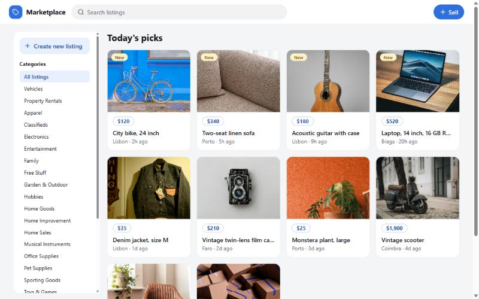
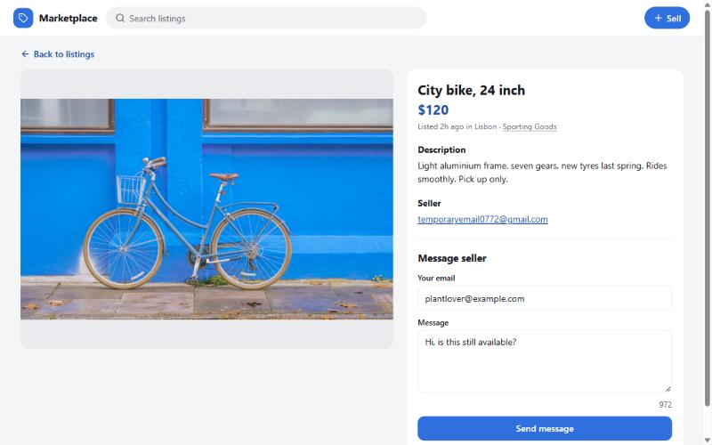
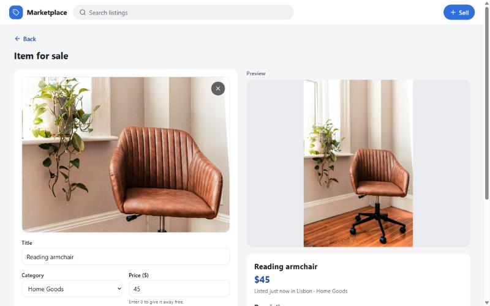
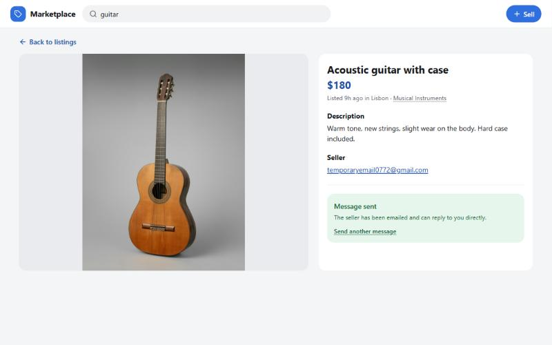

# Marketplace

A small buy-and-sell marketplace built with React, Next.js and Supabase. Sellers post an item with a photo, buyers browse by category, open a listing and message the seller.

**See it live:** _link added after deployment_



## Features

- **Create a listing** with a photo, title, description, price, category, email and optional location. Everything is saved in Supabase: the details in the database, the photo in Supabase Storage. A live preview shows the listing as you type.
- **Browse all listings** on the home page, newest first, with a category sidebar (a scrolling row of tabs on phones). Each category has its own link, such as `/?category=electronics`.
- **A page for every listing** with the full photo, price, description, category, location, when it was listed and the seller's email.
- **Message the seller** from the listing page. The buyer's email and message are saved in Supabase.
- Price range and sort (newest, price low to high, high to low), kept in the address bar so filtered views can be shared
- Photo checks before upload: JPG, PNG or WebP up to 5MB, chosen by click or drag and drop
- Loading, empty and error states, a not-found page for removed listings, and a clear notice if the database is not connected
- Works by keyboard, labelled for screen readers, and laid out for phones

## Bonus features : 

### 1. Keyword search

- A search box in the header on every page finds listings by words in the **title or description**.
- Results update as you type, and work together with the category, price range and sort filters.
- The search lives in the address bar (`/?q=guitar`), so a search can be bookmarked or shared.

### 2. Real email to the seller

- When a buyer sends a message, the seller receives a real email through [Brevo](https://www.brevo.com) (free plan, up to 300 emails a day).
- The email shows the listing title, price, a link back to the listing and the buyer's message.
- **Reply-To is set to the buyer**, so the seller just presses Reply and the conversation continues directly between the two of them by email.
- The message is always saved first. If the email cannot be sent, the buyer is told the message is saved rather than shown an error.
- The Brevo key stays on the server: emails are sent from a Next.js route handler, never from the browser.
- Limits stop the form being used to spam sellers: 5 messages per listing every 10 minutes, 10 per buyer an hour and 60 in total an hour.

## Screenshots

All screenshots are in the [`screenshots`](screenshots) folder.

| File | What it shows |
|---|---|
| [`01-home.jpg`](screenshots/01-home.jpg) | Home page: category sidebar, filters and all listings |
| [`02-category.jpg`](screenshots/02-category.jpg) | One category selected |
| [`03-search.jpg`](screenshots/03-search.jpg) | Keyword search (bonus) |
| [`04-listing.jpg`](screenshots/04-listing.jpg) | A listing page with photo, full details and Message seller |
| [`05-create-preview.jpg`](screenshots/05-create-preview.jpg) | Creating a listing, with the live preview |
| [`06-message-sent.jpg`](screenshots/06-message-sent.jpg) | A message sent to the seller |
| [`07-seller-email.png`](screenshots/07-seller-email.png) | The email the seller receives (bonus) |
| [`08-phone.png`](screenshots/08-phone.png) | The phone layout |

| Listing page | Create a listing | Message sent |
|---|---|---|
|  |  |  |

## Stack

Next.js (App Router), React 19, TypeScript and Tailwind CSS, with Supabase for the database and photo storage and Brevo for email, deployed on Vercel. The added runtime dependencies are `@supabase/supabase-js` and `lucide-react` (icons). Buttons, inputs and cards are hand-written; there is no component library.

Built with [Claude Code](https://claude.com/claude-code) as a pair programmer.

## How the data is protected

There is no login, so the pages talk to Supabase with its public key. What a visitor can do is decided by rules in the database, not by keeping that key secret:

| A visitor can | A visitor cannot |
|---|---|
| Read listings | Edit or delete any listing, or set its id or timestamp |
| Create a listing (5 per email and 50 in total an hour) | Read any message, or the buyers' email addresses |
| Upload an image of up to 5MB | Upload other file types, or overwrite, list or delete files |
| Send a message through the site, within the limits above | Write to the messages table directly |

Title, description, price, category, email and message limits are checked by the database as well as the page. All of this is in [`supabase/setup.sql`](supabase/setup.sql).

## Set it up yourself

1. Create a project at [supabase.com](https://supabase.com).
2. Open the SQL Editor, paste the contents of [`supabase/setup.sql`](supabase/setup.sql) and run it once. It creates the `listings` and `messages` tables, their access rules, the `listing-images` storage bucket and ten starter listings. The starter listings point to fixed photo file names (listed in the script); upload photos with those names to the bucket, or the starter listings show without a picture.
3. Copy `.env.example` to `.env.local` and fill in the Supabase URL and publishable (anon) key, from the project's home page under Copy or Project Settings → API.
4. For seller emails (optional): create a free [Brevo](https://www.brevo.com) account, verify a sender address, create an API key under SMTP & API, and add `BREVO_API_KEY`, `BREVO_SENDER_EMAIL` and `BREVO_SENDER_NAME` to `.env.local`. Without them, messages are still saved.
5. Install and run:

```bash
npm install
npm run dev
```

Then open http://localhost:3000.

To deploy on Vercel, import the repository and add the same values as environment variables before deploying: the two `NEXT_PUBLIC_` values as plain values and the Brevo API key as a secret. In Brevo, turn off **Authorized IPs** under Security, as Vercel does not send from a fixed address.

Notes:

- Emails from a new Brevo sender may land in the spam folder at first.
- Free Supabase projects pause after a period without activity; resume the project in the Supabase dashboard if listings stop loading.
- Starter listing photos are from [Unsplash](https://unsplash.com), used under the Unsplash License.

## Project structure

```
src/
  app/
    page.tsx              home page
    item/[id]/page.tsx    listing page
    create/               choose a listing type, then the listing form
    api/messages/         saves a message and emails the seller
  components/
    Header.tsx            logo, search and Sell button
    Sidebar.tsx           categories, price range and sort
    HomeView.tsx          the listings grid and its states
    ListingCard.tsx       one listing in the grid
    ListingDetails.tsx    photo and details, shared by the listing page and preview
    ListingPage.tsx       loads a listing for its page
    MessageSeller.tsx     the Message seller form
    CreateListingForm.tsx the listing form with live preview
    PhotoPicker.tsx       choosing and previewing a photo
    NotConfigured.tsx     notice when the database is not connected
  lib/
    categories.ts         the category list
    validation.ts         listing, message and photo rules
    format.ts             prices and "2h ago" labels
    filters.ts            category, search, price and sort in the address bar
    email.ts              the email sent to sellers
    brevo.ts              sends that email (server only)
    listings.ts           every call to Supabase
    supabase.ts           creates the Supabase client
    storage.ts            remembers the visitor's email in their browser
supabase/
  setup.sql               the database, in one script
screenshots/              screenshots of the app
```

`validation`, `format`, `filters` and `email` are plain functions covered by unit tests.

## Commands

| Command | What it does |
|---|---|
| `npm run dev` | Start the development server |
| `npm run build` | Build for production |
| `npm run start` | Serve the production build |
| `npm run test` | Run the unit tests |
| `npm run lint` | Lint the code |
| `npm run typecheck` | Check types |
